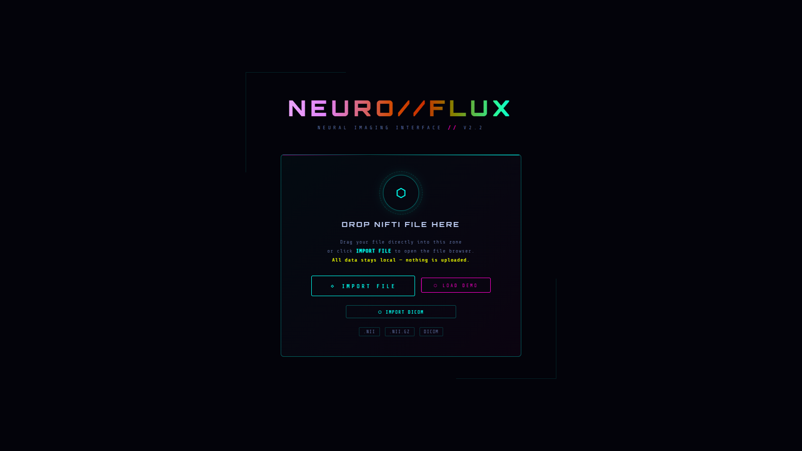
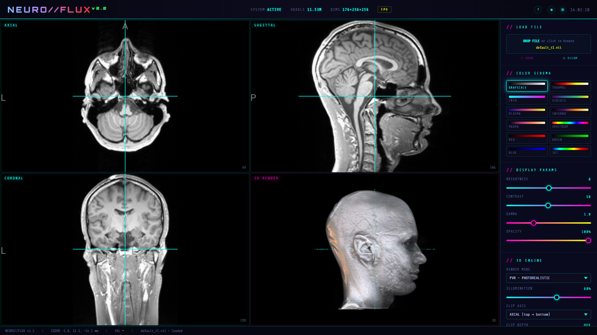
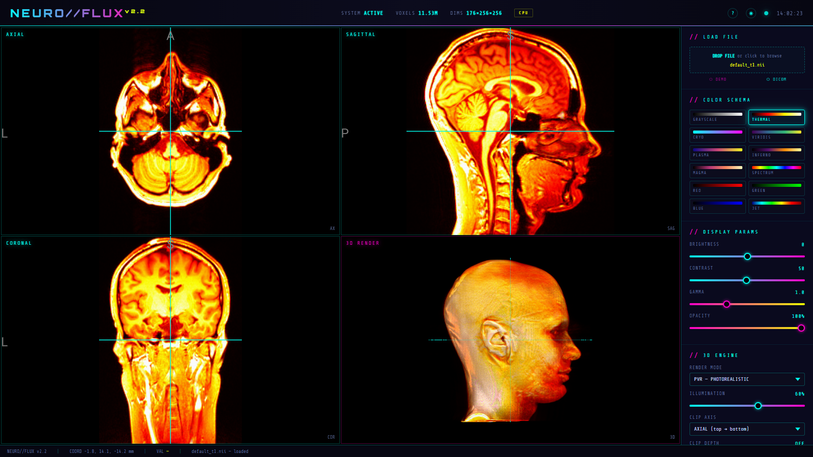
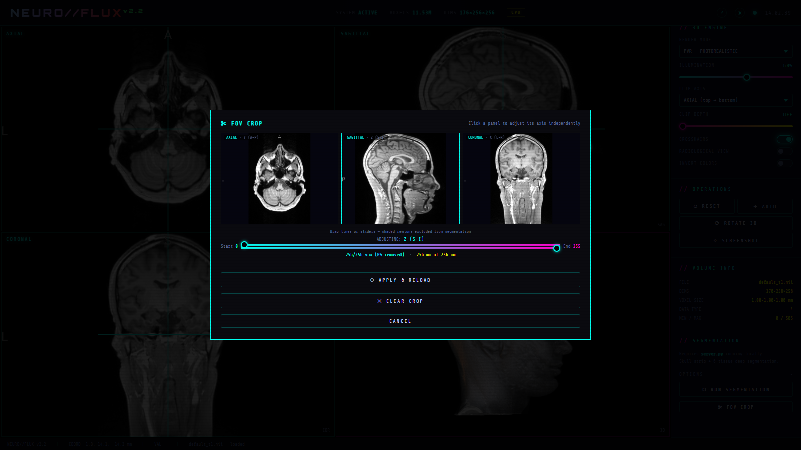
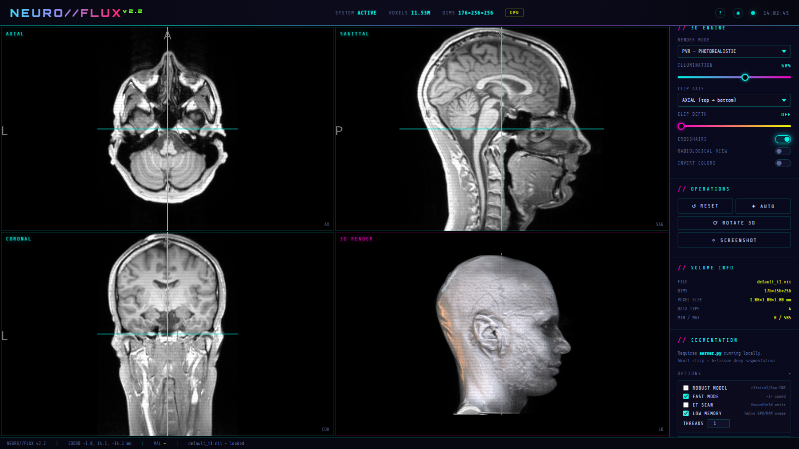
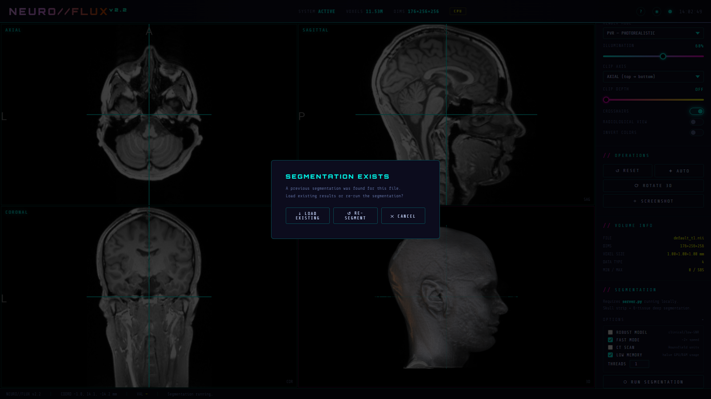
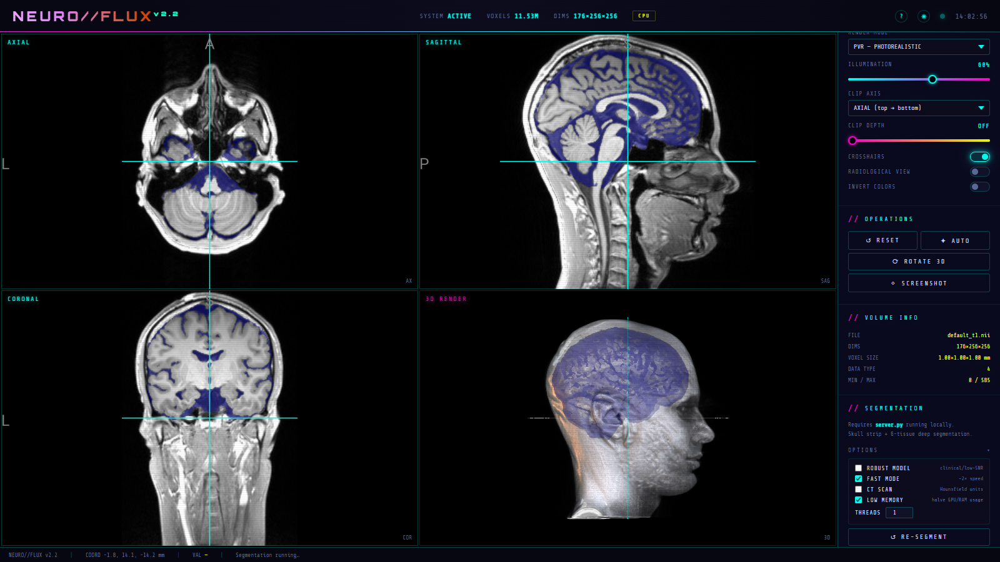
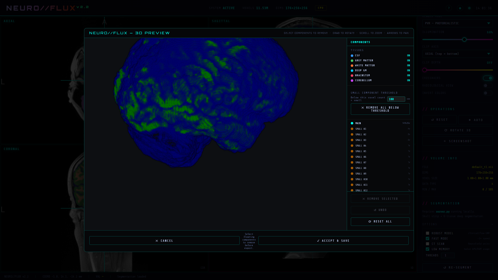
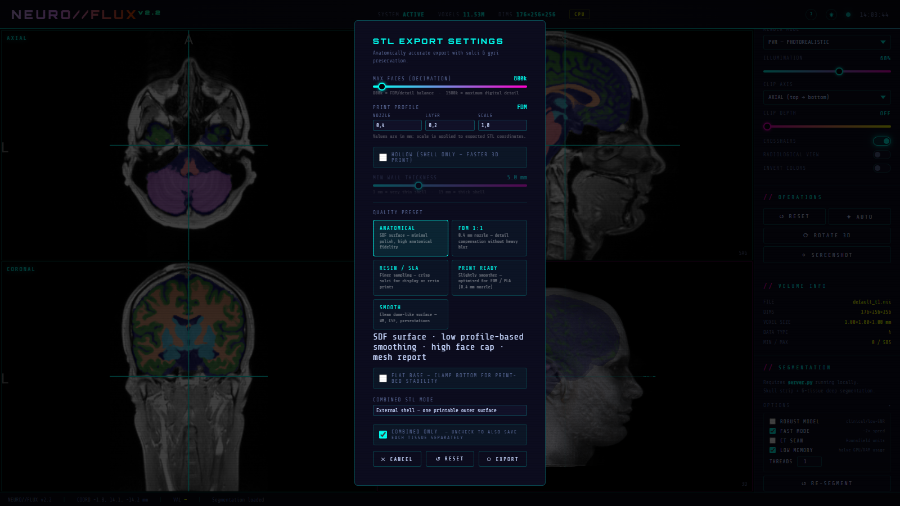
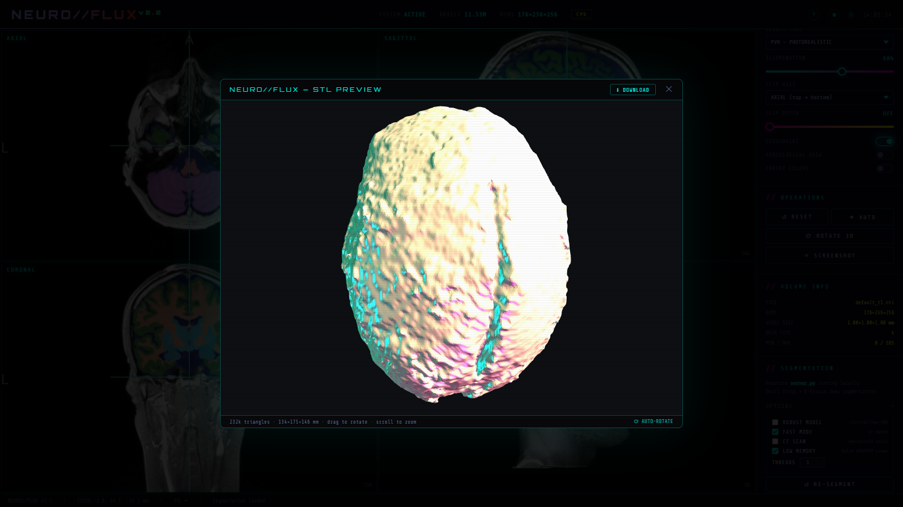

# NeuroFlux Walkthrough & UI Feature Guide

This guide provides a comprehensive visual walkthrough of the **NeuroFlux** MRI segmentation pipeline and interactive 3D viewer. It demonstrates the complete workflow from loading a clinical MRI scan to deep-learning tissue segmentation and STL mesh generation for 3D printing.

---

## ⬡ Walkthrough Video

A complete end-to-end recording of the interface interactions, segmentation workflow, and 3D export:

> 🎬 **Download high-resolution video:** [neuroflux_demo.mp4](screenshots/neuroflux_demo.mp4)

---

## ⬡ Step-by-Step UI Overview

### 1. Landing Screen & Input Sources

Upon launching NeuroFlux (`http://localhost:5050`), users are greeted with a clean, local-first interface. You can drag and drop any NIfTI scan (`.nii`, `.nii.gz`), import a DICOM series directory, or click **DEMO SCAN** to instantly load the bundled high-resolution T1-weighted scan.

- **Drag & Drop Zone:** Accepts `.nii`, `.nii.gz`, or compressed archives.
- **DICOM Import:** Automatically converts 2D DICOM slice series into 3D NIfTI volumes via `dicom2nifti`.
- **Demo Scan:** One-click instant load of FreeSurfer standard T1 reference volume for immediate exploration.

---

### 2. Multi-Planar Orthogonal & 3D Viewer

Once a scan is loaded, the 4-panel WebGL viewer (powered by NiiVue) renders synchronized Axial, Coronal, and Sagittal cross-sections alongside a real-time 3D ray-marched volume rendering.

- **Crosshair Navigation:** Clicking or dragging across any 2D slice updates all cross-sections simultaneously.
- **Voxel Coordinates & World Matrix:** Real-time RAS coordinates and millimeter scaling are displayed in the HUD.
- **Zoom & Pan:** High-performance hardware-accelerated pan and zoom with right-click / scroll-wheel.

---

### 3. Display Customization & Colormaps

NeuroFlux includes radiological windowing and dynamic colormaps to highlight soft tissue contrast and pathology.

- **Colormaps:** Switch between Grayscale, Hot, Cool, Viridis, Plasma, Bone, and Jet colormaps.
- **Intensity Windowing:** Adjustable brightness, contrast, and min/max intensity thresholds.
- **Measurement Tools:** Built-in caliper pins (Pin A & Pin B) calculate exact Euclidean distances in millimeters.

---

### 4. Automatic & Interactive FOV Brain Localizer

To prevent neck and non-brain tissue from biasing segmentation, NeuroFlux features an automated brain localizer as well as an interactive FOV crop modal.

- **Auto-Detection:** Analyzes cross-sectional area profiles along each axis to locate the brain envelope.
- **Interactive Bounding Box:** Visual boundary handles across Axial, Sagittal, and Coronal planes allow custom bounding box adjustment.
- **Memory Optimization:** Restricting inference to the cranial box reduces peak memory consumption by up to 38%.

---

### 5. Segmentation Pipeline Configuration

The sidebar provides direct controls over the SynthSeg 2.0 segmentation engine.

- **Fast Mode (`--fast`):** Runs a single-pass inference network without test-time flip augmentation (~2× faster).
- **Low-Memory Mode (`--low-memory`):** Uses shift-strict anatomically guided cropping (160×192×256 mm) and sequential tensor processing, enabling full inference on systems with 6–8 GB of RAM without clipping the cerebral vertex.
- **CPU Thread Allocation:** Configurable worker threads for CPU inference.

---

### 6. Existing Segmentation Detection & Cache

When clicking **RUN SEGMENTATION**, NeuroFlux checks whether a completed segmentation already exists in `output/segmentation/<scan_name>/`.

- **Load Existing:** Immediately load previously calculated tissue labels and volume measurements with zero waiting time.
- **Re-segment:** Force a clean segmentation pass to test different settings or flags.

---

### 7. Whole Brain Tissue Segmentation & Volumetry

Loading or completing a segmentation renders 6-class deep-learning tissue masks directly over the anatomical MRI.

- **Tissues Classified:**
  1. Cerebrospinal Fluid (CSF)
  2. Cerebral Grey Matter (GM)
  3. Cerebral White Matter (WM)
  4. Deep Grey Matter (Thalamus, Caudate, Putamen, Pallidum, Hippocampus, Amygdala)
  5. Brainstem
  6. Cerebellum
- **Volumetric Statistics:** Real-time calculation of absolute volume in cubic centimeters (\(cm^3\)) and percentage of intracranial volume (ICV).
- **Layer Toggles:** Individual visibility checkboxes allow isolating specific tissue classes.

---

### 8. 3D Surface & Mesh Preview

Clicking **SAVE 3D FILES** launches the interactive 3D Surface Mesh generator.

- **Tissue Selection:** Choose which tissue classes to include in the exported model.
- **Smoothing Iterations:** Apply Laplacian smoothing to remove voxel staircasing while preserving sulcal morphology.
- **Live 3D Rotation:** Full orbit controls allow inspecting mesh quality before saving.

---

### 9. STL Mesh Export Settings & 3D Print Presets

The STL export dialog prepares production-ready 3D meshes tailored for additive manufacturing (3D printing) or 3D visualization.

- **Quality Presets:**
  - **Standard (Balanced):** 60k faces, 0.4 mm tolerance, 8 smoothing steps.
  - **FDM 1:1 Print:** Optimized for filament printers with robust wall thickness.
  - **Resin / SLA (Fine Detail):** 200k faces for ultra-smooth resin printing.
  - **Presentation / Render:** High polygon density for rendering in Blender or Unity.
- **Combined or Multipart:** Export either a single merged solid mesh or separate STL files for each anatomical tissue.

---

### 10. Final 3D Export & Mesh Viewer

Upon confirmation, NeuroFlux generates the binary STL files into `output/3d-files/<scan_stem>/`.

- **Files Generated:** Binary `.stl` files saved directly to the project's runtime output folder.
- **Direct 3D Preview:** Visual confirmation of generated mesh geometry directly in the browser.
